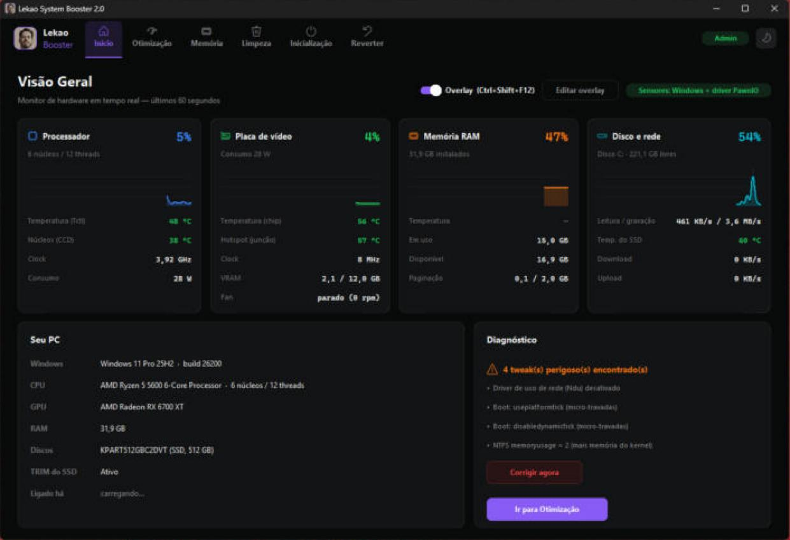
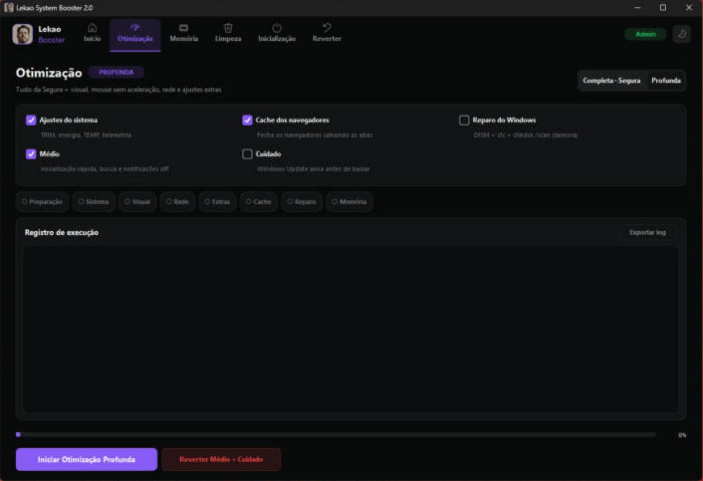
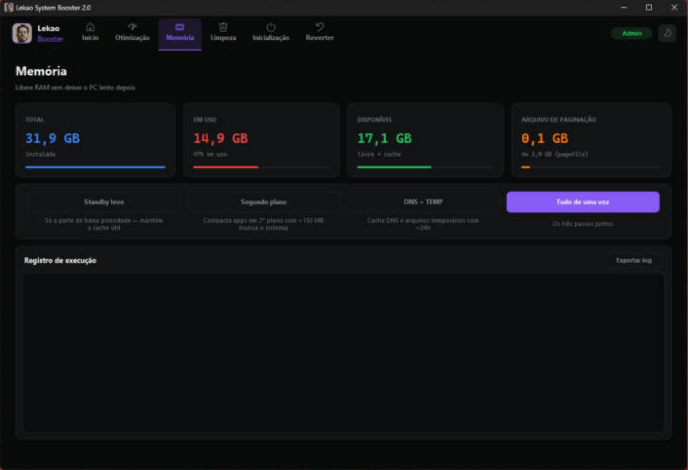
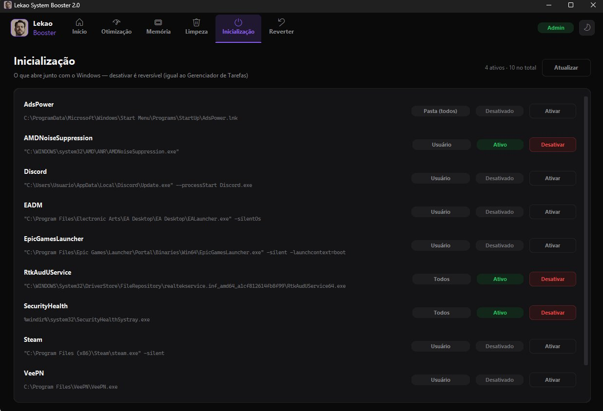
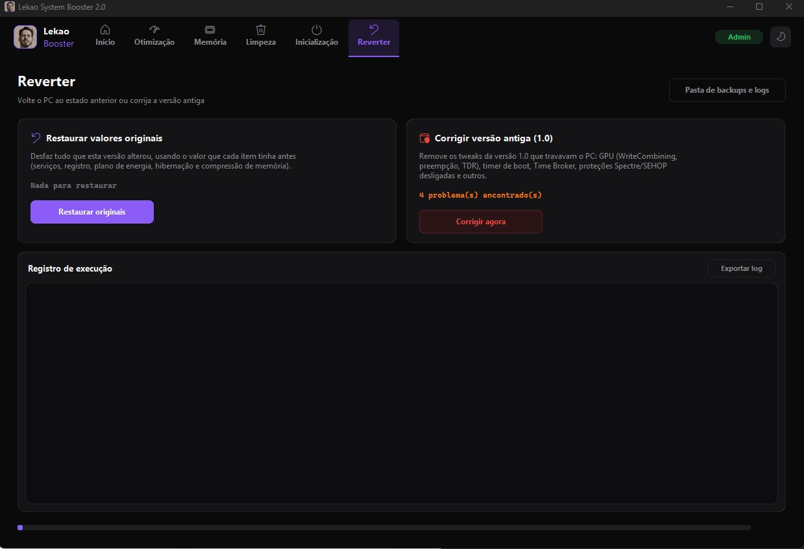

<p align="center">
  
</p>

<h1 align="center">Lekao System Booster</h1>

<p align="center">
  A safe, reversible Windows performance optimizer with a built-in hardware monitor and in-game FPS overlay.
  <br>
  <b>Python · CustomTkinter · Win32 API (ctypes) · C# / .NET · PowerShell</b>
</p>

---

## Overview

Lekao System Booster is a desktop app I built to tune Windows PCs for gaming and everyday use, based on 8+ years of hands-on PC repair and maintenance work.

Most "PC booster" tools change dozens of system settings with no way back. The core idea here is **safety first**: before any registry value or service is changed, its **original value is saved**, so a single click on *Revert* returns the PC to exactly how it was.

## Features

### Optimization (grouped by risk level)
- **System:** high-performance power plan, SSD TRIM check, drive optimization, hibernation off, foreground-app priority, multimedia scheduling, memory compression tuned to installed RAM
- **Visual:** lighter animations, menus without delay, no transparency, mouse acceleration off
- **Network:** Nagle's algorithm off for lower latency, DNS cache flush
- **Background noise:** telemetry, Game DVR, Cortana, Widgets, search indexing and notifications can be disabled individually

### Memory
- Live RAM, available memory and page-file usage
- Three cleanup levels: light standby purge (keeps the useful cache), compact background apps using more than 150 MB (never system processes), and DNS + temp files, or all of them at once
- Uses Windows privileges (`SeProfileSingleProcessPrivilege`) through `ctypes`

### Disk cleanup
- Scans any drive and shows exactly how much space each item frees before anything is deleted
- Includes **all of Windows' own Disk Cleanup categories** (Windows Update cleanup, thumbnails, delivery optimization files...), called natively via COM in a separate worker process with live progress
- Plus extra Lekao items: browser caches (Chrome, Edge, Opera, Brave, Vivaldi, Firefox; tabs are saved first) and GPU shader caches (AMD/NVIDIA/Intel)
- Each item is tagged by origin (*Windows*, *Lekao* or *Your files*), and personal folders like Downloads come with a clear warning and are never pre-selected
- Risky operations are deliberately left out: shadow copies (would delete restore points), catroot2, Windows Installer cache and OS compaction

### Startup manager
- Lists everything that starts with Windows from the registry Run keys, the Startup folders and Task Manager's approval keys
- Shows the scope (current user or all users), the full command line and the current state
- Enable/disable is fully reversible, the same mechanism Task Manager uses

### Hardware monitor & game overlay
- Real-time CPU/GPU usage, clocks, temperatures, VRAM and RAM
- Temperatures come from a small **C# helper** I wrote on top of LibreHardwareMonitorLib, which streams sensor data to the Python app over stdin/stdout and pauses itself when not needed to save CPU
- GPU load read directly from Windows kernel graphics counters (D3DKMT) and PDH performance counters
- **FPS counter** using Intel's open-source PresentMon
- **Transparent click-through overlay** (RivaTuner style) with global hotkeys. It draws a window on top of the game and injects nothing into the game process, so it carries no anti-cheat risk.

### Safety & recovery
- Automatic **System Restore point** and registry export before changes
- Original-state file (`estado_original.json`) with every value the app touched
- *Revert* tab restores every service, registry value, power plan, hibernation and memory-compression setting to the value it had before
- **Legacy fix:** detects tweaks from version 1.0 that caused stutter or crashes (GPU WriteCombining, preemption, TDR, boot timer, Time Broker, disabled Spectre/SEHOP protections) and removes them
- Every run is logged and the log can be exported

## How it works

```
┌───────────────────────────┐   stdin/stdout   ┌──────────────────────┐
│  Python app (UI + logic)  │ ◄──────────────► │ LekaoSensors.exe (C#)│
│  CustomTkinter, psutil,   │                  │ LibreHardwareMonitor │
│  winreg, ctypes, COM      │                  └──────────────────────┘
│                           │   subprocess     ┌──────────────────────┐
│  Steps: Reg / Service /   │ ───────────────► │ PowerShell, DISM,    │
│  Cmd / Func               │                  │ defrag, PresentMon   │
└────────────┬──────────────┘                  └──────────────────────┘
             │ saves before changing
             ▼
   LekaoBackups/estado_original.json  →  one-click Revert
```

- Every tweak is a typed **Step** (`Reg`, `Service`, `Cmd`, `Func`), so the same object knows how to apply itself, report status and be undone
- Long-running work runs in background threads with a queue feeding the UI, so the window never freezes
- Child processes are killed as a whole tree on timeout to avoid hangs
- Packaged as a single `.exe` with PyInstaller, and requests admin rights automatically (UAC)

## Screenshots

| Home: live hardware overview | Optimization |
|---|---|
|  |  |

| Memory | Disk cleanup |
|---|---|
|  |  |

| Startup manager | Revert & legacy fix |
|---|---|
|  |  |

**In-game overlay** (always on top, click-through, toggled with `Ctrl+Shift+F12`):


## Tech stack

| Area | Tools |
|---|---|
| Language | Python 3, C# (.NET Framework) |
| UI | CustomTkinter, Tkinter, Pillow |
| System access | `winreg`, `ctypes` (Win32, NT and D3DKMT APIs), COM, PowerShell |
| Monitoring | psutil, PDH counters, LibreHardwareMonitorLib, PresentMon |
| Packaging | PyInstaller |

## Source code

The source code is kept private. **Available upon request** for recruiters and technical reviewers.

## Author

**Alexandro Rodrigues** · IT professional & Python developer · Rio de Janeiro, Brazil
[LinkedIn](https://www.linkedin.com/in/alexandro-rodrigues-07802292/)
